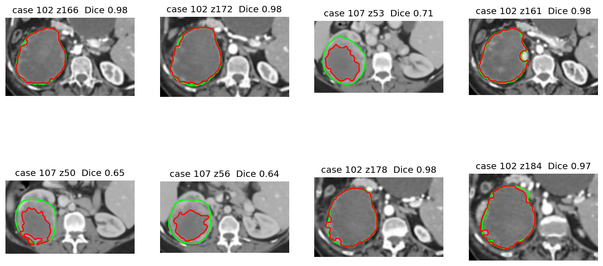

# Kidney Tumor Detection

**Classical computer-vision pipeline for kidney tumor detection in abdominal CT (KiTS23).**
No deep learning, no pre-trained models: windowing, filtering, morphology, thresholding, region growing, texture features and a Random Forest.

Coursework for *CT036-3-3 Image Processing, Computer Vision and Pattern Recognition* (APU). This repository is the **tumor** part of a group project; the kidney part is done by other group members.


*Red = predicted tumor, green = radiologist ground truth.*

## Pipeline

```
Raw CT slice (HU)
  -> Phase 1  Enhancement   window [-160, 240] HU -> anisotropic diffusion -> Butterworth low-pass
  -> Phase 2  Segmentation  morphology (custom SEs) + Multi-Otsu  |  seeded region growing
  -> Phase 3  Recognition   shape + GLCM + HU statistics -> Random Forest -> healthy vs tumor/cyst
```

| Phase | Methods compared | Evaluation |
|---|---|---|
| 1. Enhancement | Anisotropic diffusion vs Gaussian vs Median; CLAHE vs Histogram Equalization (both compared, neither in the final chain); Butterworth low-pass on the 2D DFT | PSNR, CNR |
| 2. Segmentation | Strategy A: Multi-Otsu. Strategy B: seeded region growing | Dice, IoU vs ground truth |
| 3. Classification | 15 features (6 shape, 5 GLCM over 4 angles, 4 first-order HU) -> Random Forest | 70/30 split by patient, 5-fold CV, confusion matrix, accuracy, recall, specificity, F1 |

## Results (12 patients, 72 slices)

**Segmentation (Dice / IoU against ground truth, all slices)**

| Method | Dice | IoU |
|---|---|---|
| Multi-Otsu (A) | 0.347 | 0.269 |
| Seeded region growing (B) | **0.353** | 0.289 |

Dice on the 4 held-out test patients (region growing): 0.290. Region growing barely changes under added noise, a brightness shift or a contrast change (`results/robustness.csv`).

**Classification (held-out patients, 94 regions)**

| Accuracy | Recall | Specificity | F1 | 5-fold CV accuracy |
|---|---|---|---|---|
| 0.946 | 1.000 | 0.938 | 0.818 | 0.898 +/- 0.066 |

**Enhancement quality**

| Step | PSNR (dB) | CNR |
|---|---|---|
| Original window | - | 2.19 |
| Anisotropic diffusion | **30.7** | 2.65 |
| Gaussian | 26.6 | 2.70 |
| Median | 25.7 | 2.74 |
| CLAHE | 20.6 | 1.76 |
| Histogram Equalization | 19.3 | 1.61 |
| Butterworth low-pass | 25.5 | 2.76 |
| **Final chain** (window, diffusion, Butterworth) | 25.1 | 2.88 |

Anisotropic diffusion keeps the most structure (highest PSNR) while still raising CNR. CLAHE is not in the final chain: it amplifies noise (lowest PSNR/CNR of the compared steps) and, on the 45 training slices, lowers Dice (Otsu 0.347 with CLAHE vs 0.390 without; region growing 0.244 vs 0.410).

### Honest limitations
- Segmentation is hard for classical methods here: tumors whose density matches or exceeds healthy kidney (cases 100, 103, 110) and very small tumors fail.
- The tumor search runs inside the ground-truth kidney mask (the kidney is assumed to be localized by the kidney half of the project).
- The dark-versus-bright class preference (`DARK_PREFERENCE` in `segment.py`) was tuned on the same slices it is scored on, so Dice is slightly optimistic.
- The held-out set has only 9 tumor regions, so recall 1.00 (4 false positives among 65 healthy regions) is a small-sample estimate.

## Quick start

```bash
pip install -r requirements.txt
python prepare_data.py      # downloads KiTS23 cases 100-112 (several GB) and extracts 2D slices
python run_pipeline.py      # runs all phases, writes tables and figures to results/
python app.py               # Tkinter prototype
```

The 72 extracted slices are already in `data/slices`, so you can skip the download and run the pipeline directly. `test_images/` has the held-out slices as plain PNG.

## Prototype app

`python app.py` opens a window to load one slice or a folder, pick the segmentation method, and view the mask, tumor overlay, kidney overlay and a combined view (predicted red, ground truth green), with Dice per slice and the classifier metrics. It has one tab per phase: Overview, Phase 1 Enhancement (original -> enhanced with every compared algorithm), Phase 2 Segmentation (both strategies with Dice/IoU), Phase 3 Recognition (features, classifier, diagnostic class). Run `run_pipeline.py` first so the app can load the classifier (rebuilt from the saved feature table).

## Repository layout

| File | Purpose |
|---|---|
| `preprocess.py` | Phase 1: windowing, denoising, CLAHE/HE, Butterworth, PSNR, CNR |
| `segment.py` | Phase 2: morphology, Multi-Otsu, region growing, Dice, IoU |
| `classify.py` | Phase 3: feature extraction, Random Forest, evaluation |
| `run_pipeline.py` | End-to-end run, tables and figures |
| `prepare_data.py` | KiTS23 download and slice extraction |
| `app.py` | Prototype GUI |
| `test_pipeline.py` | Automated tests (`python -m pytest -q`), also run by GitHub Actions on every PR |
| `results/` | Figures and CSV/JSON metrics, incl. `parameter_sweep.csv/png` (Phase 1 setting justification) |
| `data/slices/` | Extracted CT slices (`.npz`) |
| `test_images/` | Held-out test slices as PNG |

Each module has a small self-check: `python preprocess.py`, `python segment.py`, `python classify.py`.

## Data and credits

Data: KiTS23 kidney tumor segmentation challenge, https://kits-challenge.org/kits23/ (Heller et al.). Please follow the dataset's license and citation requirements.
